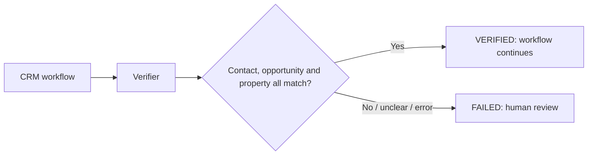

# CRM Association Verifier

A read-only check that confirms a CRM contact and opportunity point to the correct property before any automation acts on them.

## The problem

In my real estate business, CRM workflows act on linked records: a buyer (contact), a deal (opportunity) and a property. Automation can run exactly as designed and still do the wrong thing if those links are missing or wrong, for example sending a buyer details for a different property.

## What I built

A small service that sits in front of the workflow and answers one question: *are these three records really linked to each other?*

- Reads the CRM only. It never creates, edits or deletes records
- Returns `VERIFIED` only when every link and the property ID match exactly
- Anything missing, conflicting, ambiguous or erroring returns `FAILED` and goes to a person for review

**Design rule: automate the predictable path, fail closed on uncertainty, send the rest to a human.**

## My role

I defined the business problem, the exact matching rules and the human-review path, then directed AI-assisted implementation and testing.

## Result

41 automated tests cover the success case and every failure path: wrong links, mismatched IDs, API errors, timeouts and incomplete data. They run on every push (see the badge above).

**Stack:** JavaScript · Cloudflare Workers · GoHighLevel CRM API

## Technical details

- [Technical reference](docs/technical-reference.md): endpoint, failure table, safety controls, configuration, running locally
- [Architecture](docs/architecture.md) · [Runnable demo](docs/synthetic-demo.md) · [Commercial context](docs/COMMERCIAL_CONTEXT.md) · [Readiness checkpoint](docs/READINESS_2026-10-29.md)

Public portfolio copy with synthetic data only. Live account IDs, credentials and customer data are excluded. Live end-to-end CRM deployment has not been verified.

**Joel Gabriel Pascal** · [Portfolio](https://false-ash-26c.notion.site/Joel-Pascal-portfolio-Enterprise-Sales-GTM-and-Practical-AI-40b5622002f981709ab3e773187085f3) · [GitHub](https://github.com/JoelGPascal)

## Role in the broader system — 14 November 2026

This repository is the narrow relationship-verification component of PDH business automation around third-party GoHighLevel. It is distinct from JARVIS's assistant/dashboard and JOEL X's career engine. Its read-only decision result does not itself authorize, send or execute a CRM workflow.

The [technical reference](docs/technical-reference.md) documents the request contract, configuration bindings, limits and failure behavior. [Readiness](docs/READINESS_2026-10-29.md) is a dated checkpoint. A test badge supports only the workflow/run it links to; current production deployment and GHL association compatibility were not inspected during this documentation expansion.
