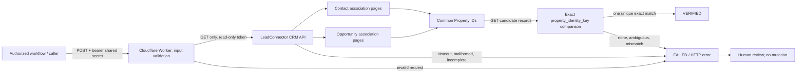

# CRM Association Verifier — Architecture and Trust Boundaries

**Evidence level:** source-inspected design, not independently executed or production-certified in this documentation update.

## Contracts

**Inbound:** `POST /verify-property-associations`, `Authorization: Bearer <shared-secret>`, JSON object containing nonempty `propertyIdentityKey`, `expectedContactId`, `expectedOpportunityId`. Identifiers are limited to 512 characters. Wrong path/method, missing authorization or malformed body fail closed.

**Outbound:** JSON `{verifierResult, verifiedPropertyId, reason}`. Only a single exact Property identity associated to *both* expected records returns `VERIFIED` with `EXACT_ASSOCIATIONS_CONFIRMED`. All other paths return `FAILED`; `verifiedPropertyId` is null on failure. The verifier never writes CRM data.

**Upstream trust boundary:** fixed `https://services.leadconnectorhq.com` origin, redirects rejected, only GET calls; token and location ID injected through environment bindings. See `.dev.vars.example` for placeholders only. No credentials belong in Git.

## Reliability controls from src/worker.js

| Control | Source limit / behavior |
| --- | --- |
| Input body | 4,096 bytes; strict JSON/object/identifier checks |
| Upstream response | 1,048,576 bytes; strict JSON decode |
| Per-request timeout | 5,000 ms; abort on expiry |
| Overall verification budget | 25,000 ms |
| Association pagination | 100 records/page, at most 10 pages per record |
| Candidate Properties | At most 20 common candidates |
| Pagination integrity | Consistent totals, no duplicate relations, complete pages required |
| Record identity | Exact case-sensitive `property_identity_key`; no fuzzy matching |
| Logging | Outcome/reason/status/elapsed time, not credentials or identifiers |

## Failure handling

| Condition | Decision |
| --- | --- |
| Contact association absent | `FAILED / CONTACT_RELATION_MISSING` |
| Opportunity association absent | `FAILED / OPPORTUNITY_RELATION_MISSING` |
| No common Property | `FAILED / NO_COMMON_PROPERTY` |
| No exact identity match | `FAILED / PROPERTY_IDENTITY_MISMATCH` |
| Multiple matches / excess candidates | `FAILED`; ambiguity is not resolved automatically |
| API error, timeout, malformed or incomplete pagination | `FAILED`; no inferred success |
| Unauthorized request | HTTP 401 and `FAILED` |

## Reproduce safely

Node.js >=22. Run `npm install` then `npm test`; optionally `npm run check:deploy` for a dry-run build. **Do not run `npm run deploy` as part of a portfolio review.** See [synthetic demo](synthetic-demo.md). These commands are instructions, not evidence they were executed in this review.

## Evidence and limitations

The current `test/worker.test.js` contains **23 top-level test declarations**. A prior **41 passing tests** claim is not reconciled with an original run artifact; no test suite was rerun for this documentation update. This sanitized code is not proof of a production deployment, authorization configuration, real CRM compatibility, or end-to-end workflow certification. Read-only verification cannot establish ownership, rights, or marketing consent.
